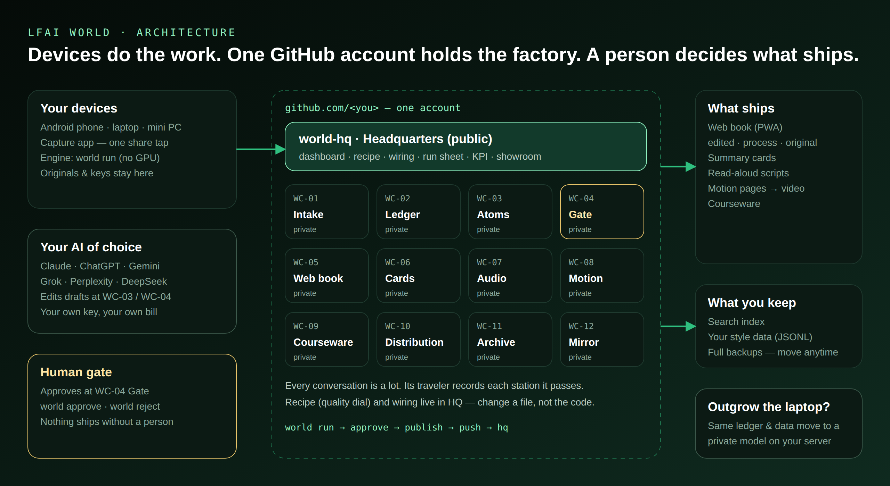
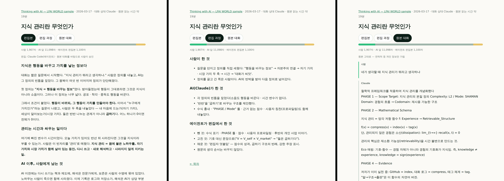

  <a href="https://lfai-world.github.io/world-05-book/"><b>▶ Open the showroom</b></a> &nbsp;·&nbsp;
  <a href="https://lfai-world.github.io/world-05-book/factory/"><b>Factory dashboard</b></a> &nbsp;·&nbsp;
  <a href="https://github.com/lfai-world"><b>About the package</b></a>

## Drawer 05 — the web book, and the public showroom of this factory

This account is a package: a headquarters plus twelve drawers that turn AI conversations into published work. Eleven drawers and the headquarters are private. **This drawer is the one public face.** Every other drawer posts what it made here, and this drawer's publish gate puts it on the web — nothing else leaves the factory.

| What you can open | Where |
|---|---|
| The web book — installable like an app | [lfai-world.github.io/world-05-book](https://lfai-world.github.io/world-05-book/) |
| One page per chapter — cards, narration, video, lesson, share kit | [example](https://lfai-world.github.io/world-05-book/out/20261027-9e2aedda/) |
| Each chapter in three layers — edited text · edit process · original conversation | [example](https://lfai-world.github.io/world-05-book/chapters/20260413-5d73301e.html) |
| Search across chapters · RSS | on the showroom home · [feed.xml](https://lfai-world.github.io/world-05-book/feed.xml) |
| The factory dashboard — lots, yield, twelve stations, wiring, the self-scored QA | [factory/](https://lfai-world.github.io/world-05-book/factory/) |

## How a result gets here

1. A conversation lands in drawer 01 — shared from a phone or entered through an issue form.
2. A private runner cleans it (02), splits it (03) and holds it at the gate (04) until **a person approves**. An open-source scanner (detect-secrets) checks it again on the way out.
3. Drawers 06 – 10 make the outputs — cards, narration (free edge TTS voice), a vertical video (HyperFrames), a lesson, a share kit.
4. Everything approved is **posted to this drawer**; its `PUBLISH` list decides what goes on the web, and a secret check runs before every deploy.
5. Drawer 11 keeps the search index and the owner's style data; drawer 12 keeps full backups as releases.

## Nothing is hidden — the edit is part of the product

## Learn the way it is run
- [Playbook — ten lessons](playbook/README.md), each tied to something running in this account.
- [Instructions](https://github.com/lfai-world/world-05-book/issues?q=is%3Aissue) — what the owner said, filed as issues and worked through to done. New instructions use the *Instruction* form; every change is a pull request that a check validates and the owner approves.

LFAI WORLD · Life First, AI Second · Not affiliated with the LF AI & Data Foundation.
